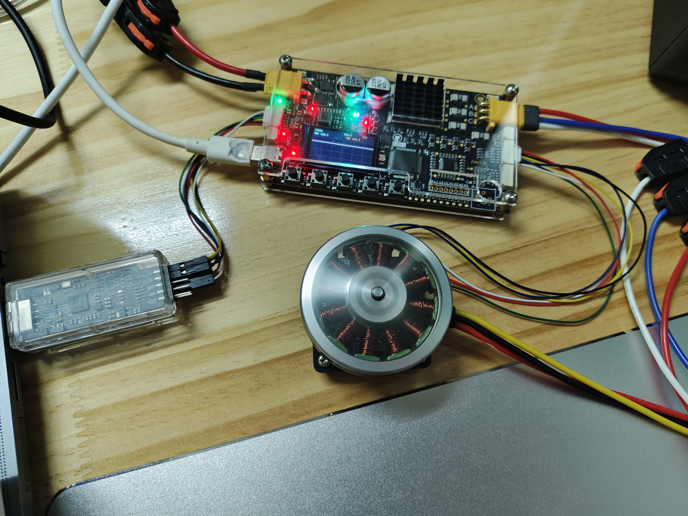
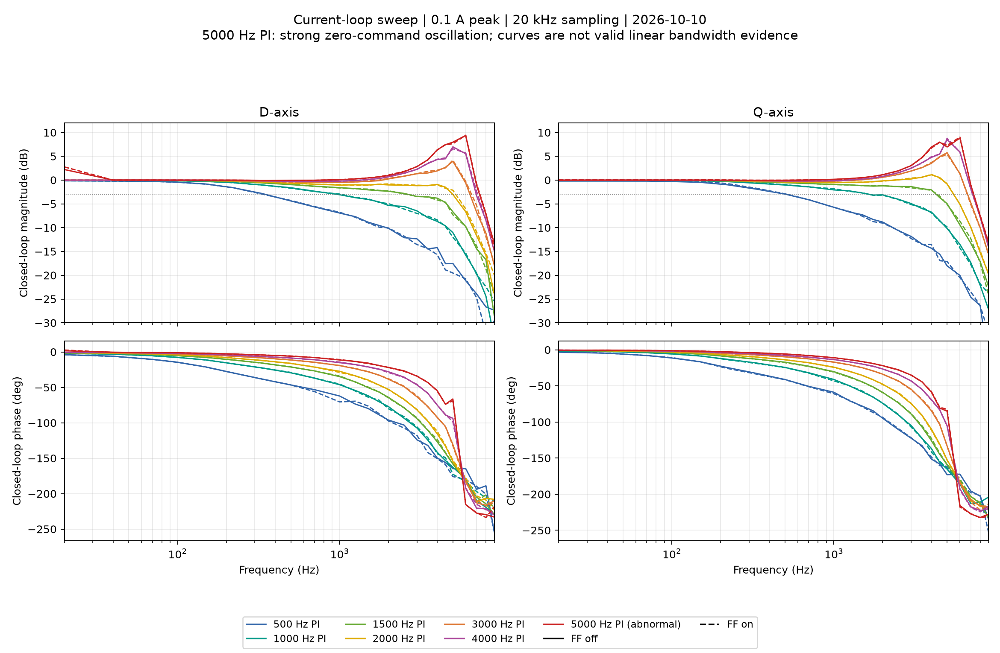

# AxDr_L_Motor

**语言 / Language：** 简体中文 | [English](docs/README.en.md)

**AxDr_L_Motor** 是面向 AxDrive-L 驱动板开发的永磁同步电机（PMSM）磁场定向控制（FOC）固件，主控为 STM32G474RET6。支持有编码器的转矩、速度和位置控制，以及基于非线性磁链观测器（NLOB）与 PLL 的无位置传感器速度控制。

有编码器控制采用 **20 kHz 电流环、2 kHz 速度环和 1 kHz 位置环**，电流环支持 PI / LADRC，配合机械 ESO 速度估计、dq 解耦与反电动势前馈。固件还提供梯形与 S 曲线轨迹、电机参数辨识、编码器校准及补偿，以及控制参数配置与保存功能。

**软件基础：** C / STM32 HAL / ThreadX / USBX。

2026-10-24 实机运行：约 24.8 V 供电，有编码器速度模式，PI 电流环，目标转速 6000 RPM；LCD 显示速度参考、反馈与实时波形。

## 主要功能

| 功能 | 具体内容 |
| --- | --- |
| 有编码器控制 | 提供转矩、速度、位置三种模式，采用机械 ESO、2 kHz 可选速度 PI / LADRC 和 1 kHz 位置 P；包含 MT6816、MT6835 SPI 编码器驱动 |
| 运动轨迹 | 支持转矩斜坡、速度与位置梯形轨迹、S 曲线轨迹；已开展运行中修改目标、正反转、位置往返及减速停止测试 |
| 电流控制 | 20 kHz dq 电流环；有感模式可切换 PI / LADRC，保留相同的速度与位置外环进行对比；支持 dq 解耦与反电动势前馈 |
| 无位置传感器控制 | 采用 I/F 启动、非线性磁链观测器（NLOB）与 PLL；固件完成转子对齐、启动、闭环接管及减速时切回 I/F |
| 电机参数辨识 | 支持定子电阻与 d/q 轴电感（Rs/Ld/Lq）、永磁体磁链、转动惯量与粘性摩擦（J/B）辨识；可读取辨识结果并应用到电机模型，配套脚本记录重复测试结果 |
| 编码器校准及补偿 | 支持编码器方向与零位寻相，以及角度误差校准与补偿；校准结果自动保存 |
| 调参与存储 | 电流与速度 PI 支持按模型和带宽计算增益，也可手动设置 Kp/Ki；手动增益独立保存，切换调参方式时保留原配置 |
| 数据与显示 | USB 可选择采集电流、速度、角度等信号，配套波形、Bode、FFT/PSD 分析；板载 LCD 显示运行模式、状态、参考值、反馈值与实时波形 |

## 控制结构

有编码器模式下，位置、速度、转矩指令分别从对应入口进入控制链路。

~~~mermaid
flowchart LR
    P["位置轨迹"] --> PC["位置 P + 轨迹速度前馈 1 kHz"]
    E["SPI 编码器"] --> PC
    E --> ESO["机械 ESO 20 kHz"]
    PC --> SC["速度 PI / LADRC 2 kHz"]
    S["速度轨迹"] --> SC
    ESO --> SC
    SC --> IQ["Iq 参考"]
    T["转矩指令 / Kt"] --> IQ
    IQ --> CC["dq 电流 PI / LADRC 20 kHz"]
    CC --> M["SVPWM / 逆变器 / PMSM"]
~~~

图中省略电流采样、坐标变换及限幅保护。控制环与轨迹实现见 [Motor/](Motor/) 和 [Motion/](Motion/)。

速度 PI/LADRC 与电流控制器独立选择；LADRC 共用机械 ESO。见[参数说明](docs/速度环与位置环调参记录.md#speed-ladrc)及 [±300 rad/s 实测对照](docs/速度环与位置环调参记录.md#speed-ladrc-regression-20261024)。

电流采样、坐标变换、电流控制及调制在 ADC 中断路径中执行，电流环每个 PWM 周期运行一次。ThreadX 线程负责运动控制调度、命令处理、USB 收发和 LCD 刷新；高频控制与通信、显示分别执行。电流环、速度环和位置环的运行频率分别为 **20 kHz / 2 kHz / 1 kHz**。

无位置传感器模式采用**转子对齐 → I/F 开环启动 → NLOB + PLL → 闭环接管**，减速至低速时可切回 I/F。启动与切换逻辑见 [Sensorless/](Sensorless/)，磁链观测器、PLL 和机械 ESO 实现见 [Observer/](Observer/)。

## 构建

需预先安装 Git、CMake 3.22+、Ninja 和 GNU Arm Embedded 工具链。

~~~bash
git clone --recurse-submodules https://github.com/BJKJKZHOU/AxDr_L_Motor.git &&
cd AxDr_L_Motor &&
cmake --preset gcc-release &&
cmake --build --preset gcc-release --parallel &&
arm-none-eabi-objcopy -O binary build/gcc-release/AxDr_L_Motor.elf build/gcc-release/AxDr_L_Motor.bin &&
arm-none-eabi-objcopy -O ihex build/gcc-release/AxDr_L_Motor.elf build/gcc-release/AxDr_L_Motor.hex
~~~

构建产物位于 `build/gcc-release/`：`AxDr_L_Motor.elf`、`AxDr_L_Motor.bin` 和 `AxDr_L_Motor.hex`。

## 实测结果

以下结果对应记录中的电机、固件与测试工况。

**编码器校准及补偿（2026-10-20）**

6000 RPM 有感 PI 速度控制下，自动校准前后各采集约 10 秒，电流环带宽与外环增益保持一致：

| 指标 | 无补偿 | 自动补偿 |
| --- | ---: | ---: |
| ESO 转速标准差 / RPM | 11.1395 | 1.7472 |
| Iq 二阶机械谐波峰值 / A | 0.42668 | 0.02162 |

本次对照中，ESO 转速标准差降低 84.3%，Iq 二阶机械谐波峰值降低 94.9%；同时验证了校准结果保存、复位加载和升速阶段停止中止。速度统计使用机械 ESO 输出，角度反馈来自电机编码器。完整条件与原始波形见[编码器校准及补偿测试记录](docs/Mechanical_ESO_有感速度测试记录_20260917.md#encoder-auto-cal-20261020)。

**PI / LADRC 电流环与三环对比（2026-10-17）**

保持速度 PI、位置 P 和轨迹参数一致，分别以 PI 与 LADRC 作为电流内环，完成速度正反转、位置往返、稳态保持、电气扰动及 Rs/Ls ±30% 模型失配比较。两种内环均完成三环运行，第二轮比较包含 24 段位置重复到位、24 段稳态保持和 96 段电气扰动测试。

所测参数下，LADRC 的位置保持 RMS 和位置电气扰动偏移峰值较小，手调 PI 的最大位置保持误差与标称模型下速度波动较小。具体参数、比较方法和各项结果见[PI/LADRC 三环对比记录](docs/PI与LADRC电流环及三环回归测试记录_20261017.md#manual-pi-tuning-20261017)。

**电流环频率响应（2026-10-10）**

20 kHz 采样，七组 PI 参数 × D/Q 两轴 × 前馈解耦开/关，共 28 组闭环扫频。高带宽设置出现增益峰化；图中标注 PI 参数设置，闭环响应由反馈与参考的比值计算，裕度由闭环响应推算。测试条件、有效性判断与原始数据见[电流环频响记录](docs/电流环频响测试.md#frf-hw-20261010)。

其他实测：

- [运动轨迹](docs/轨迹规划测试记录.md)：三种控制模式下的目标修改、正反转、位置往返、S 曲线及停止行为验证。
- [速度环频响](docs/速度环与位置环调参记录.md#speed-frf-hw-20261010)：100 rad/s 工作点下八组 PI 对照，记录 1～150 Hz 的闭环幅相响应。
- [参数辨识](docs/辨识测试记录.md)：Rs/Ld/Lq、磁链与 J/B 的测试条件、重复性及待定位问题。

## 通信与工具

通过 USB 虚拟串口（CDC）与电脑通信，使用本项目自定义协议，支持参数读写、电机启停、参数辨识、编码器校准、状态与故障上报，以及实时波形采集。配套 Python 工具位于 [tools/](tools/)。

| 用途 | 工具 |
| --- | --- |
| 新电机连续辨识与可选无感试运行 | [new_motor_commission.py](tools/new_motor_commission.py) |
| Rs/Ld/Lq、磁链与 J/B 辨识及结果记录 | [identification_test.py](tools/identification_test.py) |
| 编码器寻相 | [servo_phase_search.py](tools/servo_phase_search.py) |
| 无感运行 | [sensorless_run.py](tools/sensorless_run.py) |
| USB 波形采集、文件归档与 FFT/PSD 分析 | [fft.py](tools/fft.py) |
| 已保存波形的重绘与基波分析 | [current_waveform.py](tools/current_waveform.py) |
| 电流环与速度环扫频 | [current_frf.py](tools/current_frf.py) |

工具与专题记录的完整入口见[测试与问题记录索引](docs/测试与问题记录索引.md)，脚本参数通过 `--help` 查看。波形和频谱数据可保存为文件，用于离线重绘及不同控制参数下的结果对比。

## 硬件来源与许可

当前硬件为 [AxDrive-L](https://oshwhub.com/lylssy/foc_driver)，参考软件为 [AxDr_L](https://github.com/disnox/AxDr_L)。本仓库并非该项目的官方固件。

本固件直接驱动电机功率级，实验前必须确认硬件、电机参数和独立保护。

项目自有代码与文档使用 [Apache-2.0](LICENSE)，第三方组件详见 [THIRD_PARTY_LICENSES.md](THIRD_PARTY_LICENSES.md)。
