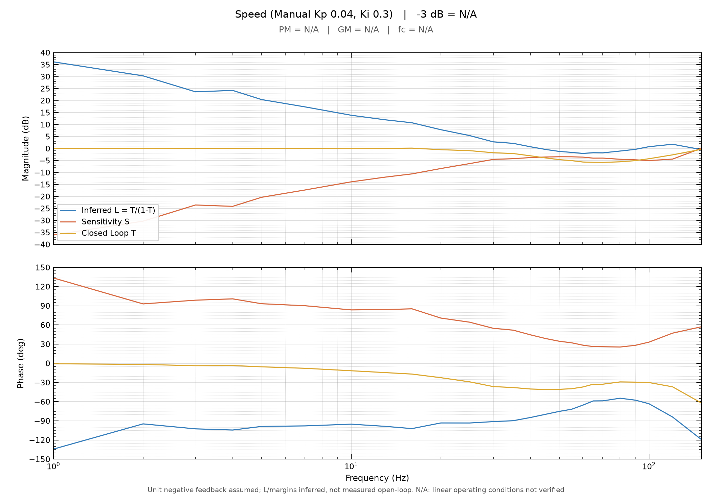

# AxDr_L_Motor

**语言 / Language：** 简体中文 | [English](docs/README.en.md)

基于 **STM32G474RET6 + AxDrive-L** 的永磁同步电机（PMSM）磁场定向控制（FOC）固件。工程持续进行实机控制、参数辨识和算法对比，并保留可复核的测试条件与数据。

**开发环境：** C / STM32 HAL / ThreadX / USBX，STM32CubeMX 配置，CMake + ST Arm Clang / GNU Arm GCC 构建，Python 分析频率响应与噪声频谱。

## 当前进展

| 方向 | 阶段 | 实测范围与限制 |
| --- | --- | --- |
| 有位置传感器伺服控制 | **基础功能已验证** | 转矩指令、速度 PI、位置 P 控制及轨迹/Stop 回归；目前以已测试的空载工况为依据。[测试记录](docs/三环基本功能测试记录_20261009.md) |
| 无位置传感器速度控制 | **限定工况已验证** | 1000 RPM 闭环运行、I/F 与观测器双向切换；150 RPM I/F 阶段仍有速度波动。[测试记录](docs/NLOB_PLL观测器测试记录.md#sensorless-accdec-20261006) |
| 电机参数辨识 | **流程已实测，精度继续验证** | 定子电阻/电感（Rs/Ls）、永磁体磁链、惯量/粘性摩擦（J/B）；磁链五次辨识变异系数 0.145%，Rs/Ls 工作点一致性仍待确认。[测试记录](docs/辨识测试记录.md) |
| 控制环频率响应测试 | **实测对照中** | Id/Iq 电流环 28 组、速度环 8 组 Bode；高带宽异常及速度环线性条件仍需核验。[记录索引](docs/测试与问题记录索引.md) |

## 控制结构

有编码器模式下的主要信号路径如下。位置、速度、转矩是**不同控制模式的指令入口**，并不是三个同时叠加的独立控制环。

~~~mermaid
flowchart LR
    P["位置轨迹"] --> PC["位置 P + 轨迹速度前馈 1 kHz"]
    E["SPI 编码器"] --> PC
    E --> ESO["机械 ESO 20 kHz"]
    PC --> SC["速度 PI 2 kHz"]
    S["速度轨迹"] --> SC
    ESO --> SC
    SC --> IQ["Iq 参考"]
    T["转矩指令 / Kt"] --> IQ
    IQ --> CC["dq 电流 PI 20 kHz"]
    CC --> M["SVPWM / 逆变器 / PMSM"]
~~~

位置 P 输出速度修正量并与轨迹速度相加；速度 PI 使用电角速度（电角速度 = 极对数 × 机械角速度），输出 Iq 参考。机械扩张状态观测器（ESO）从编码器位置等信号估计速度和扰动转矩，扰动估计当前用于诊断。图中省略电流采样、坐标变换及限幅保护。具体实现见 [Motor/](Motor/) 和 [Motion/](Motion/)。

无位置传感器模式采用**转子对齐 → I/F 开环启动 → 非线性磁链观测器 + PLL → 闭环接管**，减速至低速时可切回 I/F；对应实现见 [Sensorless/](Sensorless/) 和 [Observer/](Observer/)。

## 实测频率响应

点击缩略图可查看完整 Bode。两组测量均为**闭环频率响应**；PI 设置的设计带宽不等同于实测 −3 dB 带宽，推算的稳定裕度也不是独立断环测量。

<table>
<tr>
<td width="50%" valign="top">

<strong>Id / Iq 电流环</strong> 20 kHz 采样，七组 PI 参数 × D/Q 两轴 × 前馈解耦开/关，共 28 组。高带宽设置出现增益峰化。 <a href="docs/电流环频响测试.md#frf-hw-20261010">测试记录与原始数据</a>

</td>
<td width="50%" valign="top">

<strong>有编码器速度环</strong> 100 rad/s 工作点、1–150 Hz 激励，八组 PI 对照；图示 Manual Kp=0.04、Ki=0.3。线性条件尚未确认，带宽与裕度均为 N/A。 <a href="docs/速度环与位置环调参记录.md#speed-frf-hw-20261010">测试记录与原始数据</a>

</td>
</tr>
</table>

## 构建与文档

当前硬件为 [AxDrive-L](https://oshwhub.com/lylssy/foc_driver)（参考 [原软件](https://github.com/disnox/AxDr_L)），本仓库并非该项目的官方固件。克隆时初始化 Git 子模块；本地已克隆可执行 git submodule update --init --recursive。

~~~bash
git clone --recursive https://github.com/BJKJKZHOU/AxDr_L_Motor.git
cd AxDr_L_Motor

# GNU Arm GCC（CMake 3.22+、Ninja、arm-none-eabi-gcc）
cmake --preset gcc-release
cmake --build --preset gcc-release

# ST Arm Clang
cmake --preset Release
cmake --build --preset Release
~~~

通信当前以 USB CDC 承载 AxDr Parameter / Action / Event 与 Plot，应用层采用 CAN-FD 风格报文。实验使用的 [扫频工具](tools/current_frf.py)、[FFT/PSD 工具](tools/fft.py) 和 [测试记录索引](docs/测试与问题记录索引.md) 均可查阅；脚本随实验调整，使用前应核对与固件的兼容性。代码风格见 [CODE_STYLE.md](docs/CODE_STYLE.md)。

**安全与许可：** 本固件直接驱动电机功率级，实验前必须确认硬件、电机参数和独立保护。项目自有代码与文档使用 [Apache-2.0](LICENSE)，第三方组件详见 [THIRD_PARTY_LICENSES.md](THIRD_PARTY_LICENSES.md)。
