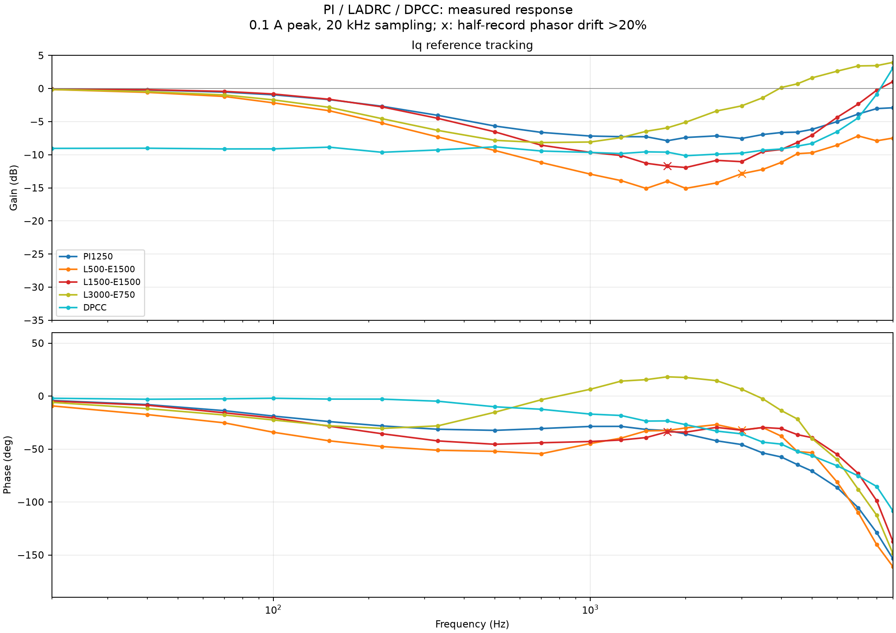
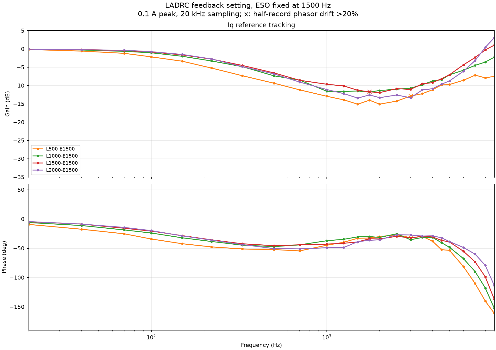
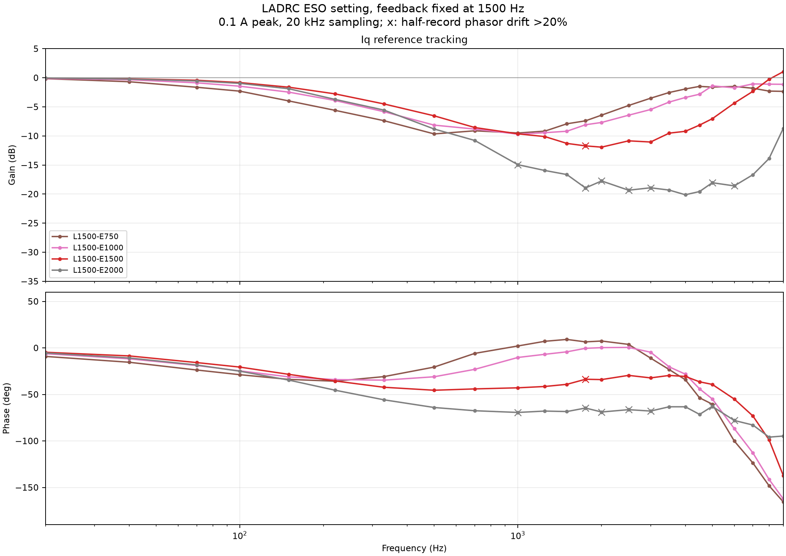
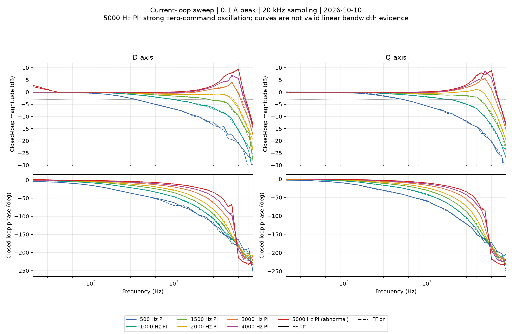
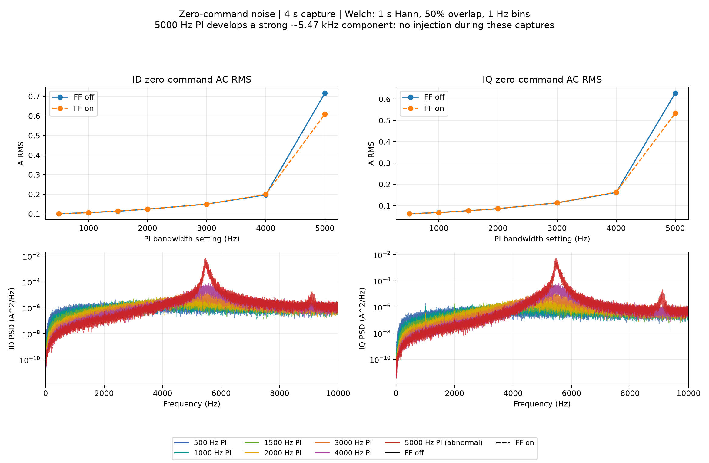
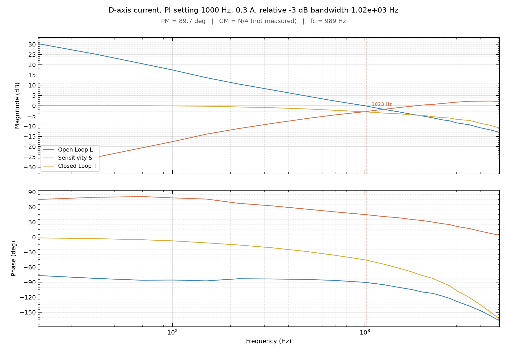
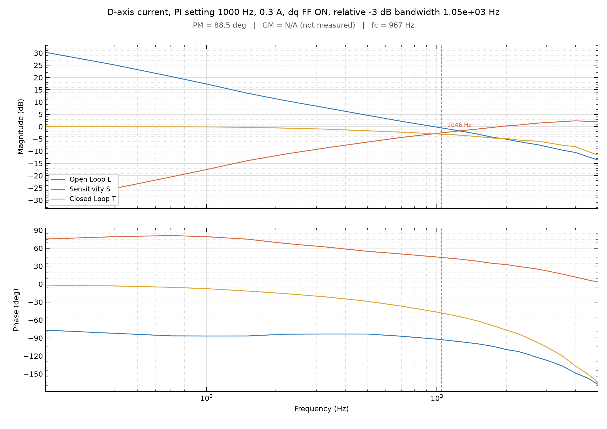

# 有感 D/Q 电流环频率响应测试

更新：2026-11-11。[PI / LADRC / DPCC 对照及 LADRC 参数扫描](#frf-hw-20261111)；[10 月 10 日七档带宽 D/Q 与 FFT 对照](#frf-hw-20261010)；[10 月 9 日 D 轴实测](#frf-hw-20261009)；[10 月 8 日历史异常](#frf-hw-20261008)。

## 2026-11-11：PI / LADRC / DPCC 对照及 LADRC 参数扫描

完成 PI 1250 Hz、8 组 LADRC 参数和 DPCC 的 D/Q 扫频，共 20 组、480 个正式频点，并采集各配置的零指令噪声。**LADRC 增益与 ESO 频率需要分别权衡：增大反馈参数的收益并不单调，ESO=2000 Hz 组的噪声和中频衰减明显增大；DPCC 相位滞后较小，但低频跟踪幅值约为参考的 35%。**

### 工况与分析口径

- 本轮为 2 mΩ 电流采样、ABZ 4096 PPR、7 极对。TORQUE + ENABLED，零转矩目标，电机空载且未机械锁定；母线各组起始读数 24.84～24.99 V。
- 共用模型 Rs=0.282525539 Ω，Ld=Lq=71.382216 μH，Flux=0.002281195 Wb；电角度零位 5.999854088 rad。前馈开启，电流指令限幅临时设为 2 A。
- PI 使用模型带宽整定 1250 Hz。LADRC 表中的两个数分别为反馈增益对应频率、ESO 极点频率，单位 Hz；DPCC 使用共用模型，无独立带宽参数。
- 每轴注入峰值 0.1 A，每点 1 s；20 kHz 同帧记录 Injection / Ref / Fbk / Out，舍弃起始 4 个周期后拟合。频点为 20、40、70、100、150、220、330、500、700、1000、1250、1500、1750、2000、2500、3000、3500、4000、4500、5000、6000、7000、8000、9000 Hz。
- 每组另以 0.1 / 0.2 A 在 100、500、1500 Hz 做 D/Q 幅值对照，每点 0.6 s。零指令记录约 2 s，采集 Id/Iq/Ud/Uq；交流 RMS 为去均值标准差，Welch 使用 20000 点、50% 重叠，频率间隔 1 Hz。
- 图表报告实测 `T=Fbk/Ref`。幅值对照存在差异，部分弱响应点还出现拟合漂移，因此本轮 Bode 归档为 `quality=unknown`，线性带宽和稳定裕度为 N/A。图中叉号表示前后半段相量漂移超过 20%，对应 `point_valid=0`；完整原始相量仅在本机保留。

当前 PI 在 100、500、1500、3000 Hz 的 D 轴 `Out/(Ref−Fbk)` 与离散 PI 公式的相对误差为 0.10%～0.21%，支持当前增益配置及通道映射一致。采样电阻、编码器和零位与 10 月记录不同，三种控制器采用本轮 PI 基线比较。

### 同条件幅相与噪声

幅相单元格为 **增益 dB / 相位 °**。`L1500-E750` 表示 LADRC 反馈参数 1500 Hz、ESO 750 Hz。

| 配置 | D 轴 500 Hz | Q 轴 500 Hz | Q 轴 1500 Hz | 零指令 Id / Iq RMS A |
|---|---:|---:|---:|---:|
| PI1250 | -6.75 / -35.7 | -5.66 / -32.4 | -7.28 / -31.5 | 0.0801 / 0.1281 |
| L500-E1500 | -12.09 / -57.9 | -9.36 / -52.2 | -15.09 / -32.9 | 0.0818 / 0.1235 |
| L1000-E1500 | -9.00 / -52.6 | -7.35 / -47.1 | -11.49 / -30.5 | 0.0822 / 0.1252 |
| L1500-E1500 | -7.68 / -53.9 | -6.55 / -45.5 | -11.29 / -39.2 | 0.0801 / 0.1316 |
| L2000-E1500 | -7.81 / -55.3 | -6.82 / -50.6 | -13.42 / -38.8 | 0.0795 / 0.1450 |
| L1500-E750 | -10.95 / -27.3 | -9.66 / -20.6 | -7.92 / +9.1 | 0.0847 / 0.1199 |
| L1500-E1000 | -9.27 / -39.9 | -8.15 / -31.0 | -9.20 / -4.2 | 0.0831 / 0.1197 |
| L1500-E2000 | -10.61 / -68.1 | -8.81 / -64.1 | -16.65 / -68.4 | 0.0764 / 0.1824 |
| L3000-E750 | -9.73 / -23.3 | -7.83 / -15.2 | -6.46 / +15.5 | 0.0846 / 0.1212 |
| DPCC | -9.45 / -7.9 | -8.81 / -10.1 | -9.56 / -23.6 | 0.0847 / 0.1619 |

补充 D 轴低、中、高频及各配置 Q 轴高频结果，单位仍为 **增益 dB / 相位 °**。† 表示该点半段相量漂移超过 20%。

| 配置 | D 轴 100 Hz | D 轴 1500 Hz | D 轴 9000 Hz | Q 轴 9000 Hz |
|---|---:|---:|---:|---:|
| PI1250 | -1.13 / -21.2 | -8.96 / -39.8 | -10.97 / -172.4 | -2.91 / -153.6 |
| L500-E1500 | -3.18 / -41.2 | -16.46 / -39.8 | -14.50 / -165.0† | -7.48 / -161.0 |
| L1000-E1500 | -1.58 / -28.4 | -13.99 / -43.0 | -10.30 / -161.7 | -2.25 / -152.4 |
| L1500-E1500 | -1.13 / -25.0 | -13.01 / -45.5 | -7.23 / -150.2 | +1.04 / -137.2 |
| L2000-E1500 | -0.95 / -23.1 | -13.59 / -47.1 | -4.60 / -138.8 | +3.07 / -113.6 |
| L1500-E750 | -3.42 / -36.5 | -10.49 / -4.1 | -9.24 / -170.8 | -2.34 / -165.5 |
| L1500-E1000 | -2.15 / -30.7 | -10.99 / -15.7 | -9.04 / -164.4 | -1.12 / -162.4 |
| L1500-E2000 | -1.27 / -28.3 | -19.22 / -66.3† | -12.49 / -114.8 | -8.70 / -94.8 |
| L3000-E750 | -2.30 / -28.4 | -8.77 / +3.9 | -2.74 / -154.0 | +3.95 / -148.6 |
| DPCC | -9.10 / +1.2 | -9.38 / -25.1 | -3.39 / -141.3 | +3.09 / -108.3 |

DPCC 在 100 Hz 的 D/Q 增益分别为 -9.10/-9.11 dB，幅值比约 0.35；零指令 Id/Iq 均值约 0.0116/0.0114 A。其 Q 轴响应在高频回升，9000 Hz 为 +3.09 dB。基础 DPCC 没有积分或独立扰动估计，本轮只比较实测跟踪响应。

### LADRC 参数取舍

**固定 ESO=1500 Hz：** 反馈参数从 500 提到 1500 Hz，D/Q 的 500 Hz 增益分别改善约 4.41/2.81 dB。继续提到 2000 Hz，500 Hz 两轴以及 Q 轴 1500 Hz 的衰减均增加；Iq 噪声由 0.1316 增至 0.1450 A，Q 轴 9000 Hz 增益由 +1.04 增至 +3.07 dB。因此本轮没有支持继续提高该反馈参数的中频跟踪收益。

**固定反馈=1500 Hz：** ESO 从 750 提到 1500 Hz，500 Hz 幅值更接近参考，但相位滞后增大；1500 Hz 处则是较低 ESO 组幅值更高。ESO 再提到 2000 Hz，500/1500 Hz 的 Q 轴衰减和滞后同时增大，Iq 噪声比 ESO=1500 Hz 增加约 39%，比 ESO=750 Hz 增加约 52%。该组还有 14 个频点的半段相量漂移超过 20%，主要位于反馈基波较弱的中高频段。

**历史 3000/750 Hz 组合：** 相比默认 500/1500 Hz，500～1500 Hz 跟踪幅值提高、相位滞后减小，Iq 噪声接近；但 500 Hz 的 D/Q 增益仍低于本轮 PI。Q 轴从 4000 Hz 起增益超过 0 dB，9000 Hz 达 +3.95 dB，D 轴同期仍为 -2.74 dB，D/Q 高频差异明显。参数选择需同时考虑低中频跟踪与高频增益回升。

### 幅值对照、重复性与数据质量

下表统计 100/500/1500 Hz、D/Q 共六个检查点。幅值对照为同轮 **0.2 A 减 0.1 A**；重复差为正式 0.1 A 扫频减预检 0.1 A。两列均为六点增益差的范围，单位 dB。

| 配置 | 幅值对照增益差 | 0.1 A 重复增益差 |
|---|---:|---:|
| PI1250 | -1.07～-0.20 | -0.67～+0.05 |
| L500-E1500 | -1.98～+0.30 | -0.28～+0.76 |
| L1000-E1500 | -2.52～-0.39 | -0.94～+0.51 |
| L1500-E1500 | -1.03～-0.13 | -0.52～+0.01 |
| L2000-E1500 | -0.22～+0.13 | -0.35～+0.04 |
| L1500-E750 | -1.19～-0.42 | -1.05～+0.46 |
| L1500-E1000 | -1.10～-0.09 | -0.11～+0.45 |
| L1500-E2000 | -0.43～+0.51 | -0.48～+0.31 |
| L3000-E750 | -1.97～-0.59 | -0.75～+0.37 |
| DPCC | +0.08～+0.98 | -0.11～+0.44 |

正式数据共 21 个频点的半段相量漂移超过 20%，Q 轴超限点在图中标出，D/Q 具体频点如下。

| 配置 | D 轴漂移超限频点 Hz | Q 轴漂移超限频点 Hz |
|---|---|---|
| L500-E1500 | 1000、7000、9000 | 3000 |
| L1000-E1500 | 1000、2000 | — |
| L1500-E1500 | — | 1750 |
| L1500-E2000 | 1500、1750、3000、4000、5000、6000、7000 | 1000、1750、2000、2500、3000、5000、6000 |

### 数据入口

[20261111_current_frf](../../data/20261111_current_frf) 仅保存三种控制器默认参数下的 Q 轴 Bode 数据及上述三张 Q 轴 Bode 图；D 轴及噪声关键结果保留在文档表格中：

- [PI 1250 Hz](../../data/20261111_current_frf/Current-IQ-PI1250-2026-11-11.bode.nmixx)。
- [LADRC 500/1500 Hz](../../data/20261111_current_frf/Current-IQ-L500-E1500-2026-11-11.bode.nmixx)。
- [DPCC 共用模型](../../data/20261111_current_frf/Current-IQ-DPCC-2026-11-11.bode.nmixx)，无独立带宽参数。

## 2026-10-10：七档电流环带宽、前馈开关及 D/Q / FFT 对照

**结论：** 完成 500、1000、1500、2000、3000、4000、5000 Hz 七档 PI 设置，每档前馈关/开、D/Q 两轴共 28 组扫频，以及 14 组无注入 FFT/PSD。当前零转矩指令工况下，500～4000 Hz 的前馈开关差异较小；3000 Hz 开始出现明显高频增益峰，4000 Hz 的峰值和噪声明显增加。**5000 Hz 出现约 5.47 kHz 强振荡，瞬时电流远超 0.1 A 激励，接近电压限幅，该档数据标记为 invalid。**

### 固件、工况与采集

- Rs=0.282525539 Ω，Ld=Lq=71.382216 μH，Flux=0.002281195 Wb；
  编码器方向 −1，电角度零位 5.533890247 rad，标定有效。
- TORQUE + ENABLED，零转矩指令，无 Run/恒速工作点；母线测试前后约 24.6 V。
  前馈为已有 dq 解耦/反电动势前馈。
- 使用现有 `tools/current_frf.py`，峰值 0.1 A，每点 1 s，20 kHz 四通道
  `Injection / Ref / Fbk / PI Out`；按脚本舍弃起始 4 周期后作含直流项的同频拟合。
  每轴 24 点：20、40、70、100、150、220、330、500、700、1000、1250、1500、
  1750、2000、2500、3000、3500、4000、4500、5000、6000、7000、8000、9000 Hz。
- 每档先 FF=0、后 FF=1，每工况先 D、后 Q，再运行现有 `tools/fft.py`。
  FFT 无正弦注入，20 kHz、约 4 s，通道 `Id / Iq / Ia / Ib / Ic / Ud / Uq`；
  去均值、周期 Hann 窗，FFT 按相干增益校正峰值；Welch 为 20000 点、50% 重叠，
  频率间隔 1 Hz。下表 RMS 为完整原始记录的交流标准差。
- 正式扫频保存 17,732,340 个样本，FFT 保存 1,124,480 个样本。

采集工具用法见[控制环频响测试方法](../../guides/控制环频响测试方法.md)。

### 频响结果

表中每格为 **前馈关 / 开**。−3 dB 相对最低三个频点的平均增益，按对数频率插值；PM 为 `L=T/(1−T)` 推算的 D/Q 两轴较小值。峰值为本轮已采频点中 D/Q 的最大值。

| PI 设置 Hz | D 轴相对 −3 dB Hz | Q 轴相对 −3 dB Hz | D/Q 最小推算 PM ° | D/Q 最大闭环增益 dB |
|---:|---:|---:|---:|---:|
| 500 | 367 / 360 | 539 / 514 | 92.9 / 92.2 | −0.16 / +0.07 |
| 1000 | 1003 / 1046 | 1712 / 1643 | 81.0 / 81.6 | −0.07 / +0.03 |
| 1500 | 2678 / 2633 | 4303 / 4343 | 70.5 / 70.2 | −0.05 / +0.02 |
| 2000 | 5007 / 5216 | 5495 / 5492 | 59.6 / 59.3 | +1.10 / +1.19 |
| 3000 | 6377 / 6523 | 6699 / 6655 | 43.7 / 43.3 | +5.75 / +5.41 |
| 4000 | 6971 / 7106 | 7192 / 7178 | 32.5 / 32.2 | +8.51 / +8.77 |
| 5000 | N/A | N/A | N/A | +9.37 / +9.40（异常响应） |

3000 Hz 档最小推算增益裕度约 5.0 dB，4000 Hz 约 3.0 dB；高带宽档同时出现共振峰和噪声增大。

1000 Hz D 轴结果与 10 月 9 日约 1 kHz 的结果接近；相同 PI 下 D/Q 带宽不同，500 Hz D 轴也与历史 0.3 A 激励结果不同。由原始相量复算 PI Out/(Ref−Fbk)，与离散 PI Kp + Ki*Ts/(1−exp(−jωTs)) 的复数相对误差中位数约 0.14%～0.46%。

### FFT、5000 Hz 异常及脚本裕度问题

下表每格仍为 **前馈关 / 开**，均为无注入、零转矩指令记录。

| PI 设置 Hz | Id 交流 RMS A | Iq 交流 RMS A |
|---:|---:|---:|
| 500 | 0.1003 / 0.1006 | 0.0617 / 0.0617 |
| 1000 | 0.1063 / 0.1056 | 0.0676 / 0.0670 |
| 1500 | 0.1133 / 0.1145 | 0.0758 / 0.0758 |
| 2000 | 0.1239 / 0.1238 | 0.0857 / 0.0859 |
| 3000 | 0.1496 / 0.1491 | 0.1127 / 0.1131 |
| 4000 | 0.1970 / 0.1996 | 0.1617 / 0.1632 |
| 5000 | 0.7161 / 0.6089 | 0.6277 / 0.5337 |

4000 Hz、前馈关闭的 Id/Iq RMS 分别约为 2000 Hz 的 1.59/1.89 倍。5000 Hz 的 PSD 主峰为 FF=0 时 5467 Hz、FF=1 时 5464 Hz，两个电流轴均明显出现；同工况零指令记录的 dq 矢量峰值为 6.05/4.43 A，电压矢量峰值为 12.47/10.85 V。扫频中单轴反馈峰值最高 6.384 A，单频拟合反馈残差 RMS 最高约 1.71 A，远大于0.1 A 激励。拟合得到约 7.2～7.3 kHz 的 −3 dB 交点；该工况出现强振荡，归档带宽标为 N/A。

**采集异常：** 5000 Hz 档出现大电流。测试时电流指令上限为 2 A；采集工具检查状态、遥测序号和 int16 饱和，实际电流峰值异常在离线复核时发现。

**采集时的分析脚本问题（现已完成离线修复）：** 5000 Hz D 轴在 20 Hz 的异常相量使 `np.unwrap` 选到整体高 360° 的分支，`bode_metrics` 原样输出 PM=375.36°/377.63°，GM 未找到。以 100～1000 Hz 的连续滞后分支核对后，对应表观 PM 约 15.36°/17.63°，表观 GM 约 1.42/1.47 dB；Q 轴表观 PM 约 23.2°。该工况存在强振荡，归档标记为 invalid，带宽与裕度显示 N/A。修正脚本相位分支计算后重绘 PNG，归档相量保留原值。

500～4000 Hz 档的前馈开关对照中，零指令 RMS 差异较小。

### 数据归档

仓库整理后，正式目录 [20261010_current_frf](../../data/20261010_current_frf) 保留：

- 两张汇总图及 28 张分工况 Bode 图，分工况图片见下表。

14 组零指令 FFT/PSD 的结果见汇总图及本文数值。

| PI 设置 Hz | D 轴 FF=0 | D 轴 FF=1 | Q 轴 FF=0 | Q 轴 FF=1 |
|---:|---|---|---|---|
| 500 | [PNG](../../data/20261010_current_frf/Current-D-BW500Hz-FF0-2026-10-10.bode.png) | [PNG](../../data/20261010_current_frf/Current-D-BW500Hz-FF1-2026-10-10.bode.png) | [PNG](../../data/20261010_current_frf/Current-Q-BW500Hz-FF0-2026-10-10.bode.png) | [PNG](../../data/20261010_current_frf/Current-Q-BW500Hz-FF1-2026-10-10.bode.png) |
| 1000 | [PNG](../../data/20261010_current_frf/Current-D-BW1000Hz-FF0-2026-10-10.bode.png) | [PNG](../../data/20261010_current_frf/Current-D-BW1000Hz-FF1-2026-10-10.bode.png) | [PNG](../../data/20261010_current_frf/Current-Q-BW1000Hz-FF0-2026-10-10.bode.png) | [PNG](../../data/20261010_current_frf/Current-Q-BW1000Hz-FF1-2026-10-10.bode.png) |
| 1500 | [PNG](../../data/20261010_current_frf/Current-D-BW1500Hz-FF0-2026-10-10.bode.png) | [PNG](../../data/20261010_current_frf/Current-D-BW1500Hz-FF1-2026-10-10.bode.png) | [PNG](../../data/20261010_current_frf/Current-Q-BW1500Hz-FF0-2026-10-10.bode.png) | [PNG](../../data/20261010_current_frf/Current-Q-BW1500Hz-FF1-2026-10-10.bode.png) |
| 2000 | [PNG](../../data/20261010_current_frf/Current-D-BW2000Hz-FF0-2026-10-10.bode.png) | [PNG](../../data/20261010_current_frf/Current-D-BW2000Hz-FF1-2026-10-10.bode.png) | [PNG](../../data/20261010_current_frf/Current-Q-BW2000Hz-FF0-2026-10-10.bode.png) | [PNG](../../data/20261010_current_frf/Current-Q-BW2000Hz-FF1-2026-10-10.bode.png) |
| 3000 | [PNG](../../data/20261010_current_frf/Current-D-BW3000Hz-FF0-2026-10-10.bode.png) | [PNG](../../data/20261010_current_frf/Current-D-BW3000Hz-FF1-2026-10-10.bode.png) | [PNG](../../data/20261010_current_frf/Current-Q-BW3000Hz-FF0-2026-10-10.bode.png) | [PNG](../../data/20261010_current_frf/Current-Q-BW3000Hz-FF1-2026-10-10.bode.png) |
| 4000 | [PNG](../../data/20261010_current_frf/Current-D-BW4000Hz-FF0-2026-10-10.bode.png) | [PNG](../../data/20261010_current_frf/Current-D-BW4000Hz-FF1-2026-10-10.bode.png) | [PNG](../../data/20261010_current_frf/Current-Q-BW4000Hz-FF0-2026-10-10.bode.png) | [PNG](../../data/20261010_current_frf/Current-Q-BW4000Hz-FF1-2026-10-10.bode.png) |
| 5000（异常） | [PNG](../../data/20261010_current_frf/Current-D-BW5000Hz-FF0-2026-10-10.bode.png) | [PNG](../../data/20261010_current_frf/Current-D-BW5000Hz-FF1-2026-10-10.bode.png) | [PNG](../../data/20261010_current_frf/Current-Q-BW5000Hz-FF0-2026-10-10.bode.png) | [PNG](../../data/20261010_current_frf/Current-Q-BW5000Hz-FF1-2026-10-10.bode.png) |

## 2026-10-09：1000 Hz D 轴扫频复测

TORQUE + ENABLED，Iq_ref=0；24.7 V 母线，电流环 20 kHz，Bandwidth 模式 1000 Hz，Rs=0.282525539 Ω、Ld=Lq=71.382216 μH，Kp=0.448507688、Ki=1775.160318；本轮保存的编码器方向 −1、电角度零位 5.533890247 rad。采样 20 kHz、每点 1 s、峰值 0.3 A，20～5000 Hz 共 22 点；舍弃起始 max(4 周期, 50 ms)，同频正余弦拟合。

| 工况 | 相对 −3 dB 频率 | 推算 L 的 0 dB 交叉频率 | 推算相位裕度 |
|---|---:|---:|---:|
| 前馈关闭 | 1022.67 Hz | 988.66 Hz | 89.70° |
| 前馈开启 | 1046.41 Hz | 966.50 Hz | 88.48° |

两组数据保存在 [Current-D-2026-10-09.bode.nmixx](../../data/20261009_current_frf/Current-D-2026-10-09.bode.nmixx)，ref/fbk/out 对应 IdRef/Id/UdPI 复数相量，loop_id=0、ff_enabled=[0,1]。

2026-10-08 的 1000 Hz PI 测得绝对 −3 dB 频率约 3519 Hz，本轮约 1 kHz。电机与编码器保持安装，两个记录的电角度零位相差约 0.573 rad。

## 2026-10-08：旧频响实验（异常记录，仅保留结论）

TORQUE + ENABLED，母线约 24.6 V，Iq_ref=0；电流环 20 kHz，ADC 2×47.5 cycles、40 MHz，前馈关闭。固件源码提交`aa04259`，注入峰值 0.3 A，每频点 1 s，20～5000 Hz 共 22 点，先后使用 2000、1000、500 Hz 的 Bandwidth 设置。本轮历史频点拟合值与 10 月 9 日的复测不一致。

| 电流环 PI 设置 | 旧报告绝对 −3 dB | 按相对低频 −3 dB 复算 |
|---|---:|---:|
| 500 Hz | 484.7 Hz | 499.4 Hz |
| 1000 Hz | 3519.1 Hz | 3534.1 Hz |
| 2000 Hz | 5000 Hz 以内未测到 | 5000 Hz 以内未测到 |

旧 1000 Hz 响应在 1250～2750 Hz 存在约 −2.3 dB 平台；旧 2000 Hz 在 4500 Hz 出现 +2.379 dB 增益峰。旧记录 UdPI/(IdRef−Id) 在 100 Hz 及以上与理论离散 PI 基本一致。

同轮还验证了注入自然结束、Stop、Disable 和 Abort 能撤销激励。注入使 ADC_Run 中位耗时约增加0.93 μs；Disable 后出现 IdRef 遥测残留，重新 Enable 后归零。

旧实验仅保留本节结果表。原 Bode/PSD 数据位于历史提交 204215f 的 docs/data/current_frf_20261008/。
