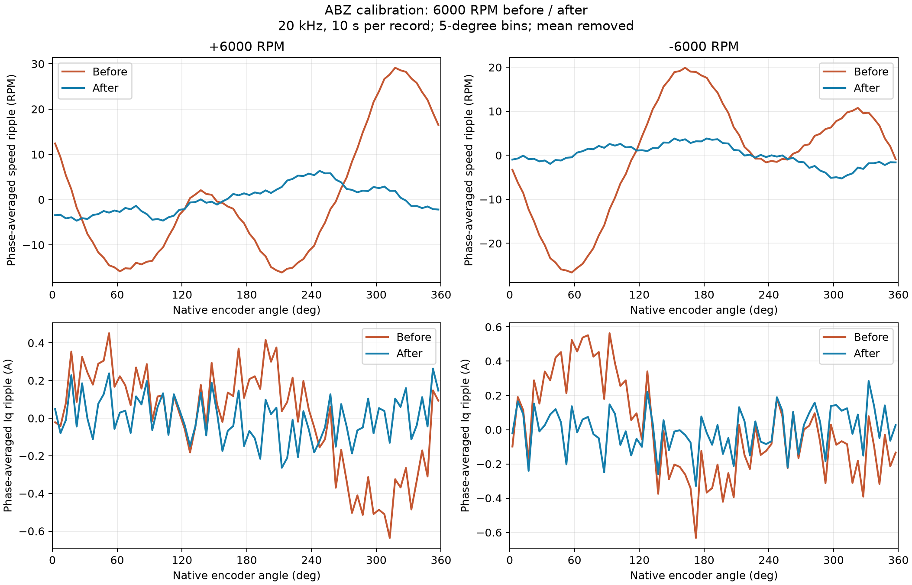

# ABZ 三环与校准测试记录

日期：2026-10-30。ABZ 编码器 4096 PPR，TIM3 四倍频为 16384 count/rev；接线从 GND 侧起为 `GND A B Z 空 VCC`。

## 控制参数与自动测试入口

空载小电机，7 极对。电流环 PI、带宽 1250 Hz；速度环 PI，Kp=0.025、Ki=0.2；位置 Kp=40。电流上限沿用 10 A。按本次要求，将板上加速度、减速度均设为 **500 rad/s²** 并保存 Flash，固件默认常量未修改。

[servo_test.py](../../../tools/servo_test.py) 通过 USB Parameter/Action 自动下发目标、通过 NORMAL Plot 采集给定与反馈，不依赖 SWD。

```bash
python3 tools/servo_test.py --port /dev/ttyACM0 --run
```

默认覆盖 ±1000、±3000、±6000 RPM，梯形、等时长 S 曲线、等峰值加速度 S 曲线；每种轨迹做 3 组 `+1圈 → 原点 → -1圈 → 原点`，另测运动中反向和 STOP/RUN。位置速度设定为 10 rad/s。`--phase-search` 可在测试前寻相，寻相结果由固件保存。

脚本沿用板上编码器、环路参数及加减速度，只临时改变模式、目标和轨迹类型。输出保存在 `test-data/日期_servo/批次/`，包含 NMIXX 原始波形和结果。电流仅统计均值、偏差、标准差及 RMS，没有电流 RMS 合格阈值。速度判定使用 `max(2 rad/s, 目标幅值的5%)`；位置要求参考到达目标、位置误差不超过 0.01 rad、速度低于 0.5 rad/s，保持 0.25 s。

## 三环自动运行结果

本轮在完整 ABZ 谐波校准之前执行，已有寻相，沿用原有谐波系数。每种轨迹有 12 个速度工况、14 个位置到位检查。末段速度统计取最后 150 ms；位置端点通过 `int32 圈数 + float 单圈角` 读回。

| 轨迹 | 速度参考峰值加速度 / rad/s² | 最大末段平均速度偏差 / RPM | 最大到位误差 / ° | 最大运动跟随误差 / ° |
|---|---:|---:|---:|---:|
| 梯形 | 500.000 | 0.930 | 0.286 | 3.845 |
| 等时长 S 曲线 | 937.531 | 0.679 | 0.220 | 2.472 |
| 等峰值 S 曲线 | 500.061 | 0.543 | 0.176 | 3.268 |

等时长 S 曲线峰值为设定加速度的 1.875 倍。等峰值 S 曲线保持 500 rad/s²，延长加减速时间。位置动态跟随误差使用 NORMAL 合成圈数信号；此轮约 160 圈坐标下，一个 float ULP 约为 0.0055°。

独立电流段的 `+0.2 / -0.2 / 0 A` 目标，对应 Iq 均值为 `+0.201 / -0.182 / -0.018 A`，标准差为 `0.173 / 0.232 / 0.176 A`。小电流测量波动单独记录，不按固定 0.15 A 阈值判断电机异常。

## 完整校准与保存异常

通过 `ACTION_ENC_CAL_START` 执行有感升速、VF 采样和谐波拟合。SWD 只用于失败后的状态定位；运行与波形采集由 USB 脚本完成。12000 点拟合残差 RMS 为 **0.05730°**，固件门槛为 0.25°。

第一次完整流程约 9.286 s 后返回 `ERR_CONFIG`：RAM 已应用新四系数，Flash 最新记录只写到 C1、S1，C2、S2 未写入，寻相有效标记为 0。随后在失能状态通过 USB 重试参数保存成功，再由脚本运行寻相，完成新系数与相位保存。首次保存中止的具体原因尚未确定，自动校准流程的问题未作源码修复。

| 参数 | 校准前沿用值 | 本次 ABZ 校准后 |
|---|---:|---:|
| C1 / rad | 0.0001272311 | -0.0000239097 |
| S1 / rad | -0.0002507138 | 0.0015352366 |
| C2 / rad | -0.0009836493 | -0.0017692433 |
| S2 / rad | -0.0014531118 | 0.0003466027 |
| Enc_Dir | -1 | -1 |
| Theta_Off / rad | 3.4994249 | 3.4442353 |

校准前为刚才实际使用的旧补偿状态，并非零系数。校准后同时更新了谐波补偿和寻相零位。

## ±6000 RPM 校准前后对比

每组保持相同 PI 参数、梯形轨迹和 500/500 rad/s²。到达目标后额外等待 2 s，再用 FAST 20 kHz 采集约 10.015 s。通道为原始机械角、ESO 速度、FOC 电角度、Id、Iq、Ia、Ib、Ic。

| 指标 | +6000 校准前 | +6000 校准后 | -6000 校准前 | -6000 校准后 |
|---|---:|---:|---:|---:|
| 原始角斜率平均转速 / RPM | 6000.038 | 6000.031 | -6000.032 | -6000.016 |
| ESO 速度标准差 / RPM | 14.108 | 3.333 | 13.278 | 2.636 |
| ESO 速度机械 2× 峰值 / RPM | 14.415 | 0.851 | 13.660 | 0.757 |
| Iq 均值 / A | 0.288 | 0.287 | -0.311 | -0.306 |
| Iq 标准差 / A | 0.357 | 0.265 | 0.373 | 0.276 |
| Iq 机械 2× 峰值 / A | 0.2421 | 0.0136 | 0.2359 | 0.0125 |
| 三相合成 RMS / A | 0.414 | 0.375 | 0.436 | 0.392 |
| 相电流绝对峰值 / A | 1.853 | 1.772 | 1.974 | 1.732 |

正、反向速度标准差分别降低约 **76.4%、80.2%**，Iq 机械二次谐波峰值分别降低约 **94.4%、94.7%**。平均 Iq 基本不变，主要改善为周期性波动降低。

机械 2× 对应 200 Hz。幅值通过原始机械角的常数项、1×/2× 正余弦联合最小二乘拟合计算；标准差去均值；三相合成 RMS 为 `sqrt(mean((Ia²+Ib²+Ic²)/3))`。图中按原始机械角每 5° 分箱平均，以展示角度同步波动。



原始数据：[正向校准前](../../data/20261030_abz_cal_6000rpm/ABZ-Before-+6000RPM-2026-10-30.waveform.nmixx)、[正向校准后](../../data/20261030_abz_cal_6000rpm/ABZ-After-+6000RPM-2026-10-30.waveform.nmixx)、[反向校准前](../../data/20261030_abz_cal_6000rpm/ABZ-Before--6000RPM-2026-10-30.waveform.nmixx)、[反向校准后](../../data/20261030_abz_cal_6000rpm/ABZ-After--6000RPM-2026-10-30.waveform.nmixx)。
