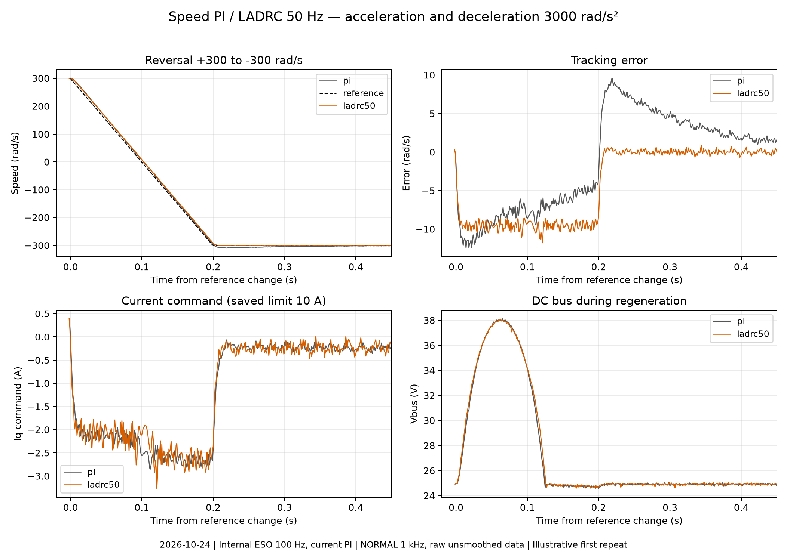

# 速度环与位置环调参记录

更新：2026-10-24。包含速度 LADRC 参数与实机回归，以及有感速度 PI、位置 P 的历史实测与速度环闭环扫频记录。

<a id="speed-ladrc"></a>

## 速度 LADRC

有感速度/位置模式支持 PI（默认）和 LADRC，电流控制器独立选择。无感、辨识及编码器校准使用 PI。

| 参数 | ID | 含义 |
| --- | --- | --- |
| `PARAM_CTRL_SPEED_CONTROLLER` | `0x0A16` | `0=PI`、`1=LADRC`；默认 PI |
| `PARAM_CTRL_SPEED_LADRC_BW_HZ` | `0x0A17` | LADRC 线性反馈增益对应频率；默认 50 Hz，范围 (0, 500] Hz |
| `PARAM_CTRL_MECH_ESO_BW_HZ` | `0x0A30` | 共用机械 ESO 的观测带宽；同时影响速度估计与扰动补偿 |

速度控制器选择和 LADRC 增益仅在 DISABLED 下可写，仅 RAM 生效；上电恢复默认值。PI 参数独立配置。

速度 LADRC 在 2 kHz 下执行，共用 20 kHz 机械 ESO 的同周期 `Wm/Td` 估计和电机模型：

```text
Kt = 1.5 × Pp × Flux
ωc = 2π × Control_Speed_LADRC_Bw_Hz
Iq = [J × ωc × (We_ref/Pp − Wm) + B × Wm + Td] / Kt
```

`We_ref` 为电角速度，`Wm` 为机械角速度；正 `Td` 表示阻碍正向运动的扰动转矩，补偿项为 `+Td/Kt`。输出沿用现有电流限幅，观测状态由共用机械 ESO 提供。

<a id="speed-ladrc-regression-20261024"></a>

### 实机回归（2026-10-24）

| 测试条件 | 设置 |
| --- | --- |
| 电机模型 | J=1.67804×10⁻⁵ kg·m²，B=1.28199×10⁻⁵ N·m·s/rad，Flux=0.00228119 Wb |
| 供电与限流 | 起始母线 24.94 V；电流限值 10 A |
| 内环与观测器 | 电流 PI 1250 Hz，前馈开启；机械 ESO 100 Hz |
| 速度控制器 | PI：Kp=0.025、Ki=0.2；LADRC：50 Hz |
| 运动指令 | `0 → 100 → 300 → −300 → 100 → Stop` rad/s；加减速度 3000 rad/s² |
| 采集 | PI/LADRC 交替各两轮；NORMAL 1 kHz，每轮统计 6.8 s |

跟踪误差取轨迹参考减 ESO 速度；超调取各运动段越过目标的最大值。Iq 反馈取内部遥测。

| 速度控制器 | 轮次 | IAE（rad） | 峰值跟踪误差（rad/s） | 最大超调（rad/s） | Iq 反馈 RMS（A） | Iq 指令峰值（A） |
| --- | ---: | ---: | ---: | ---: | ---: | ---: |
| PI | 1 | 8.051 | 13.672 | 9.593 | 0.671 | 2.851 |
| PI | 2 | 7.969 | 13.957 | 8.984 | 0.679 | 2.798 |
| LADRC 50 Hz | 1 | 5.802 | 11.797 | 1.293 | 0.670 | 3.273 |
| LADRC 50 Hz | 2 | 5.727 | 11.602 | 1.226 | 0.680 | 3.049 |

LADRC 的跟踪误差和超调较小，Iq 指令峰值较高。四轮母线峰值最大为 38.626 V。



位置往返：Kp=40，速度 20 rad/s，加减速度 100 rad/s²，目标为相对起点 `0.25 → 1 → 2 → 0 → 2π → −2π → 0` rad。各目标保持后读取 15 次编码器位置，最大绝对误差为 PI **0.0603°**、LADRC **0.0950°**。

速度/位置动作和参数写入限制检查通过；快环最大耗时 39.753 μs。

[原始波形与对比图](../../data/20261024_speed_ladrc_regression)；完整日志与固件备份：`test-data/20261024_speed_ladrc_regression/`。

<a id="speed-frf-hw-20261010"></a>

## 有感速度环闭环频响（2026-10-10：100 rad/s 八组采集）

有感速度环支持 `SPEED + ENABLED` 零速扫频，以及在用户先将电机运行至稳定转速后执行 `SPEED + RUN` 工作点扫频。扫频脚本不发送 Run/Stop，也不写速度指令；每个频点结束撤销正弦，电机维持原速度目标，直到用户主动 Stop。激励在 Ramp/S-Curve 生成之后、`Speed_Loop(WeRef, WeFbk)` 之前叠加，因此测量不含用户速度目标轨迹规划，却包含实际 20 kHz 电流内环和 Mechanical ESO。`WeRef`、`WeFbk`、速度 PI 输出 `IqRef` 和实际电角速度激励在2 kHz Motor Thread 的同一迭代中原子化发布到 FAST Plot。20 kHz FAST 的多次重复是 2 kHz 控制信号的保持值，不意味着速度 PI 更新为 20 kHz。

`tools/current_frf.py --loop speed` 使用机械 rad/s 输入幅值；测量实际进入 PI 的电角速度参考与同周期 ESO 电角速度反馈。Manual 速度 PI 以实际有效 `Kp/Ki` 记录调参条件，配置带宽字段单独保存。`.bode.nmixx` 额外保存每个频点拟合得到的平均机械速度参考、ESO 反馈速度以及 Iq 命令，供非零工作点之间比较；机械速度以内部坐标记录。本轮采用 0.5 rad/s 机械速度小信号、1～150 Hz 扫频，结合工作点、Iq 命令、故障状态和相量拟合质量检查数据。完整命令、`Speed-YYYY-MM-DD.bode.nmixx` 的字段定义与 A4 绘图规则见[频响测试说明](../current/电流环频响测试.md)。

在 `SPEED + RUN`、目标 **100 rad/s** 下完成速度 PI10、20、30、40、50、60、70 Hz 和原手调 `Kp=0.04、Ki=0.3` 共八组 Bode。

### 条件与量程

- 电流环 Bandwidth 2000 Hz、前馈关闭、Mechanical ESO 100 Hz，母线约 24.6～24.7 V；
  沿用板上电机模型、编码器标定和机械配置。
- 每档在失能状态设置 PI，启动并确认 100 rad/s 工作点稳定后调用现有
  `tools/current_frf.py --loop speed --amp 0.5 --duration 2 --plot`。
  频点为 `1, 2, 3, 4, 5, 7, 10, 13, 16, 20, 25, 30, 35, 40, 45, 50, 55, 60, 65, 70, 80, 90, 100, 120, 150 Hz`。
  每点至少 2 s，低频按脚本延长至至少 7 周期，舍弃前 4 周期。
- 临时 Iq 指令限值 2 A、速度限值 120 rad/s；加减速沿用 100 rad/s²。
- 7 极对下 100 rad/s 对应电角速度 700 rad/s，旧 Ref/Fbk FAST 比例 0.02
  的量程不足。本轮仅将这两个通道改为 0.05，并同步脚本；
  注入通道仍为 0.02，Iq 输出仍为 0.001。新 Ref/Fbk 机械速度量程约 ±234 rad/s。
  固件和采集脚本需配套；NMIXX 中已转换为物理单位的相量无需再次缩放。

17 项扫频工具离线检查通过。

### 实测对照

表中增益为实测闭环 `T=Fbk/Ref`，带宽列是 **PI 设置**。Kp/Ki 为固件实际有效值，输入为电角速度误差；Iq 峰值是速度 PI 命令，电流数据取自内部遥测。每个工况名链接到对应独立 PNG。

| PI 工况 | Kp | Ki | T @ 30 Hz（dB） | T @ 70 Hz（dB） | Iq 命令峰值（A） | 相量漂移检查通过点数 |
|---|---:|---:|---:|---:|---:|---:|
| [10 Hz](../../data/20261010_speed_frf/Speed-Wm100radps-BW10Hz-FF0-2026-10-10.bode.png) | 0.00628828 | 0.00480413 | −12.84 | −19.11 | 0.263 | 18/25 |
| [20 Hz](../../data/20261010_speed_frf/Speed-Wm100radps-BW20Hz-FF0-2026-10-10.bode.png) | 0.01257655 | 0.00960825 | −8.43 | −13.68 | 0.319 | 20/25 |
| [30 Hz](../../data/20261010_speed_frf/Speed-Wm100radps-BW30Hz-FF0-2026-10-10.bode.png) | 0.01886483 | 0.01441238 | −3.86 | −10.69 | 0.384 | 23/25 |
| [40 Hz](../../data/20261010_speed_frf/Speed-Wm100radps-BW40Hz-FF0-2026-10-10.bode.png) | 0.02515311 | 0.01921650 | −3.63 | −8.55 | 0.454 | 24/25 |
| [50 Hz](../../data/20261010_speed_frf/Speed-Wm100radps-BW50Hz-FF0-2026-10-10.bode.png) | 0.03144138 | 0.02402063 | −2.72 | −7.05 | 0.522 | 25/25 |
| [60 Hz](../../data/20261010_speed_frf/Speed-Wm100radps-BW60Hz-FF0-2026-10-10.bode.png) | 0.03772966 | 0.02882475 | −1.48 | −6.25 | 0.605 | 25/25 |
| [70 Hz](../../data/20261010_speed_frf/Speed-Wm100radps-BW70Hz-FF0-2026-10-10.bode.png) | 0.04401794 | 0.03362888 | −1.79 | −5.37 | 0.726 | 25/25 |
| [Manual](../../data/20261010_speed_frf/Speed-Wm100radps-Manual-Kp0.04-Ki0.3-FF0-2026-10-10.bode.png) | 0.04 | 0.3 | −1.75 | −5.78 | 0.635 | 25/25 |

全部 200 个频点的拟合平均反馈速度为 99.984～100.031 rad/s；非注入频率的拟合残差约 0.462～0.492 rad/s RMS，与 0.5 rad/s 注入峰值相近。表中通过点数的判据为参考/反馈前后半段相量漂移不超过 20%。本轮仅进行单一幅值采集，保留脚本的 `quality=unknown` 和逐点质量字段，图中带宽、PM、GM 均为 N/A。`L=T/(1−T)` 按单位负反馈假设由闭环响应推算。

提高 PI 设置后，30～70 Hz 的跟踪总体增强，Iq 命令峰值也增大。手调组在 40 Hz 为 −3.04 dB，70 Hz 为 −5.78 dB，150 Hz 又回升至 −0.33 dB；70 Hz 设置组在 150 Hz 达 +0.23 dB。曲线存在高频回升，扫频上限又只有 150 Hz。

### 数据归档

[归档数据与图](../../data/20261010_speed_frf)含八组 Bode。10,348,620 个四通道 FAST 样本、日志和参数快照位于 `test-data/speed_frf_20261010/Wm100radps_formal/`。

<a id="speed-manual-hw-20261007"></a>

## NVS 上板验收与速度环 Manual 调参（2026-10-07）

在 24.7 V、空载、5～40 rad/s 工况下，最终选用 `Speed Source=Manual、Kp=0.04、Ki=0.3`。

### 试验条件与调参顺序

电流环保持 Bandwidth 2000 Hz，机械 ESO 保持 100 Hz，位置环 Kp 保持 20。速度环输入为电角速度误差 `We`，输出为 `Iq_Ref`；下表为手动设置的 Kp/Ki。

每组在 DISABLED 修改增益，Enable/Run 后执行零速、正向低速、正向较高速、零速、反向低速、反向较高速、零速，再 Stop/Disable。Acc/Dec 暂设 100 rad/s²。试验电流限幅暂设 2 A；前半轮速度限制 30 rad/s，40 rad/s试验时改为 60 rad/s。

使用 1 kHz NORMAL 遥测记录母线、ESO 反馈速度、实际规划速度参考、Iq 指令与反馈、Ia/Ib、单圈角度、速度 PI 积分项和误差。涉及角度和 PI 内部量的 Plot 指针在断使能状态下临时配置，结束后恢复。所有速度指标来自固件反馈。统计表使用每段最后 500 ms 的标准差，正反向分别计算再取平均。

先在 ±5/±20 rad/s 下执行：

1. 原参数基线：Kp=0.018864831、Ki=0.014412376。
2. Ki=0，单独比较 Kp=0.02/0.03/0.04，低速波动随 Kp 增大而减小，但存在静差。
3. Kp=0.04，分别比较 Ki=0.1/0.3/0.6。积分增强加快初始误差消除；Ki=0.6
   在 20 rad/s 的速度、电流指令波动略高于 Ki=0.3，未选用。
4. Ki=0.3，再比较 Kp=0.05/0.06。低速结果较好，曾保存 0.06/0.3；追加
   40 rad/s 工况后发现不同趋势，继续测试并最终更新为 0.04/0.3。

### 40 rad/s 对比与最终选择

固定 Ki=0.3，分别测试以下 Kp。40 rad/s 约为 382 rpm；低速比较段使用 10 rad/s。

| Kp | 10 rad/s 速度标准差（rad/s） | 40 rad/s 速度标准差（rad/s） | 40 rad/s Iq 指令标准差（A） |
|---:|---:|---:|---:|
| 0.02 | 0.959 | 0.655 | 0.092 |
| 0.03 | 0.721 | 0.665 | 0.140 |
| 0.04 | 0.567 | 0.691 | 0.194 |
| 0.06 | 0.423 | 0.818 | 0.344 |
| 0.08 | 0.296 | 0.988 | 0.554 |

较大 Kp 在低速下有利，但在 40 rad/s 下增加了反馈速度和电流指令波动。只看 40 rad/s，0.02 的电流指令波动更小；综合低速跟踪，本次暂选 0.04/0.3。本轮选值为 Kp=0.04、Ki=0.3。

最终以 0.04/0.3 完成 ±5/±40 rad/s 复测，每个目标保持 5 s，含准备与收尾共采集 36.103 s：

| 工况 | 最后 500 ms 平均速度（rad/s） | 速度标准差（rad/s） |
|---|---:|---:|
| +5 rad/s | 5.0042 | 0.6077 |
| -5 rad/s | -4.9566 | 0.4999 |
| +40 rad/s | 40.0002 | 0.6911 |
| -40 rad/s | -40.0035 | 0.7033 |

最终轮 Iq 指令峰值为 0.64384 A；1 kHz 遥测样本中三相绝对值最大为 1.12793 A，上述电流统计的采样率为 1 kHz。40 rad/s 的平均值接近目标，反馈包含周期波动。对应频谱在约 89 Hz 和 229 Hz 有分量；40 rad/s 时分别约对应每转 14 和 36 次。这两个分量记录于内部速度反馈频谱。

### 现场观察与选值

有效运动测试共记录 321.160 s，含零速、准备和收尾。快环累计历史最大耗时不超过 43.2625 μs。

低速测试的现场主观观察为持续有声、声音基本不随运动变化，未感到振动。声音反馈作为现场观察记录，采集数据为电机内部速度与电流遥测。

最终保存 Speed Source=Manual，Kp=0.04、Ki=0.3，重启后读回一致。

<a id="position-kp-20261007"></a>

## 位置环 Kp 实机比较与保存（2026-10-07）

### 动作、统计与边界

母线约 24.7 V、空载，测试时临时电流限幅 2 A、速度限幅 60 rad/s。每组在断使能时设定 Kp，然后执行两遍相同的低速序列：`0 → 0.25 → 0 → 1 → 2 → 1 rad`，速度幅值 5 rad/s，加减速度 10 rad/s²。相对原点单圈角度沿用[轨迹规划测试记录](轨迹规划测试记录.md#position-retuned-20261007)。每组共 12 个低速保持点，下表剔除两次回原点准备动作，统计其余 10 个比较动作；短行程不一定达到设定的最高速度。

随后从 1 rad 出发，到 `+4 圈 → 0 → −4 圈 → 0`，速度幅值 40 rad/s、加减速度 100 rad/s²。第一段位移为 `4×2π−1 rad`，其余为四圈，各段均达到40 rad/s。全部目标在规划结束后保持 5 s，位置测量期间保持 RUN、MOE 有效。

遥测为 1 kHz，误差符号、规划结束时刻及持续保持判据沿用[轨迹规划测试记录](轨迹规划测试记录.md#position-retuned-20261007)。下表“最长时间”是规划结束后进入误差带，并在剩余观测中持续保持至少 0.5 s所需的最长时间；未通过的动作不计入该最大值，另列通过数。保持波动使用 4.5～5 s 窗口，各动作分别去均值后，取方差平均值的平方根。位置误差和保持波动均以内部编码器反馈为测量基准。

### 低速比较

| 位置 Kp | 运行中最大跟随误差 | 规划结束最大绝对误差 | ±0.5° 最长时间 | ±0.1° 通过数 / 最长时间 | 保持位置标准差 | 保持 Iq 指令标准差 |
|---:|---:|---:|---:|---|---:|---:|
| 15 | 3.504° | 2.394° | 0.531 s | 9/10；4.440 s | 0.0240° | 0.0179 A |
| 20 | 3.042° | 2.000° | 0.430 s | 9/10；4.497 s | 0.0229° | 0.0171 A |
| 30 | 2.349° | 1.502° | 0.280 s | 10/10；2.018 s | 0.0220° | 0.0187 A |
| 40 | 1.890° | 1.190° | 0.199 s | 10/10；0.503 s | 0.0211° | 0.0189 A |

Kp=40 的两次正向接近 1 rad，规划结束误差分别为 +0.843°、+0.860°，持续进入 ±0.1° 分别需 0.221 s、0.287 s；两次反向接近分别为 +1.129°、+1.190°，需 0.393 s、0.380 s。反向时正误差表示实际位置已越过目标，因此仍存在瞬态超调；规划结束后的最大方向性超调从 Kp=20 的约 2.000° 降到 1.190°。

Kp=40 各低速比较动作在 4.5～5 s 窗口的最大单点绝对误差为 0.0862°。本组空载低速序列的 10 个比较动作均满足 ±0.1° 保持判据。

### 40 rad/s 比较与选值

| 位置 Kp | 规划结束最大绝对误差 | ±0.1° 最长时间（均 4/4 通过） | 保持位置标准差 | 保持 Iq 指令标准差 | 运行 Iq 指令峰值 |
|---:|---:|---:|---:|---:|---:|
| 15 | 0.655° | 0.819 s | 0.0117° | 0.0118 A | 0.666 A |
| 20 | 0.569° | 0.554 s | 0.0120° | 0.0136 A | 0.677 A |
| 30 | 0.398° | 0.228 s | 0.0107° | 0.0124 A | 0.712 A |
| 40 | 0.324° | 0.099 s | 0.0120° | 0.0143 A | 0.728 A |

在本次四个候选中，40 的低速和高速收敛均更快，超调没有恶化，保持位置波动与 20 相近。代价是保持 Iq 指令标准差略增，高速运行电流指令峰值从约 0.677 A升到 0.728 A，仍未触及测试限幅。30 在高速保持波动方面稍小，但综合到位响应本次选择 40。四组按增益递增顺序测试，每组低速重复两遍。

### 最终选值

四组遥测时长分别为 91.596、91.581、91.606、91.616 s，共 **366.399 s**。快环累计历史最大仍为 6899 cycles（160 MHz 下 43.119 μs）。

比较后保存位置 Kp=40，重启读回一致。

最终选用速度 PI Kp/Ki=0.04/0.3、位置 Kp=40。

## 2026-09-17：200 RPM 速度环带宽扫描

固定：

- target = +200 RPM；
- ESO BW = 100 Hz；
- current limit = 1 A；
- 每组运行 10 s；
- 统计最后 8 s。

| Speed BW | 平均转速 | ESO 速度标准差 | 旧差分速度标准差 | Iq Ref 标准差 |
| --- | ---: | ---: | ---: | ---: |
| 10 Hz | 199.06 RPM | 8.91 RPM | 7.61 RPM | 0.0402 A |
| 20 Hz | 199.55 RPM | 8.50 RPM | 7.91 RPM | 0.0781 A |
| 50 Hz | 199.88 RPM | 6.73 RPM | 7.64 RPM | 0.1544 A |

从 50 Hz 降到 10 Hz：

- `Iq Ref` 纹波下降约 74%；
- 旧编码器差分速度纹波基本不变；
- ESO 速度纹波反而增大。

Speed PI 对周期速度反馈产生相应电流补偿；降低速度带宽后 Iq 指令纹波减小，ESO 速度纹波增大。

## 2026-10-06：速度环带宽扫描

模型：Pp=7，Rs=0.27184373 Ω，Ld=Lq=69.88887 μH，Flux=0.002282380 Wb，J=1.670428e-5 kg·m²，B=8.001845e-6 N·m·s/rad。

### 速度环带宽扫描与当前选择

固定模型、电流环 2000 Hz、ESO 100 Hz，测试有感 10/20/30/40/60 Hz 和无感 20/30/40/60 Hz。下表均为 +80 rad/s、末段约 3 s；排除失能后的遥测尾帧。

| 速度环设计带宽 (Hz) | 有感 ESO 标准差 (rad/s) | 有感 Iq 指令标准差 (A) | 无感旁路 ESO 标准差 (rad/s) |
| --- | ---: | ---: | ---: |
| 10 | 0.505 | 0.022 | — |
| 20 | 0.500 | 0.043 | 0.447 |
| 30 | 0.457 | 0.060 | 0.488 |
| 40 | 0.453 | 0.079 | 0.541 |
| 60 | 0.462 | 0.120 | 0.581 |

30 Hz 相比 20 Hz 在有感侧有一定收益；40→60 Hz 没有进一步明显改善，电流指令波动增大。无感侧提高带宽没有一致的纹波收益。额外完成有感 +20、+150 的 20/30 Hz 对照，以及无感 +150、有感 -80 的 30 Hz 复核：

- 有感 +20：ESO 标准差 0.922→0.835 rad/s；
- 有感 +150：ESO 标准差 0.559→0.518 rad/s，平均跟踪偏差减小；
- 有感 -80 / 30 Hz：ESO 标准差 0.615 rad/s，未优于本轮 20 Hz 基线 0.579 rad/s；
- 无感 +150 / 30 Hz：ESO、编码器、PLL 平均值分别为 150.0371、150.0381、150.0386 rad/s。

最终将 **30 Hz 保存为当前电机的速度环调试值**，使用 Bandwidth 来源，Kp=0.0187695399、Ki=0.0089911642；机械 ESO 仍为 100 Hz。本节测试时速度环代码缺省仍为 20 Hz，开发板启动时由 NVS 的 30 Hz 覆盖。

### 速度环 30 Hz 默认值与 RAM / Flash 同步

SPD_BW_HZ_DEFAULT 从 20 Hz 调为 30 Hz，与本轮保存值一致。

最终源码默认值、RAM 及 Flash 的速度环带宽均为 **30 Hz**，Kp=0.018864831、Ki=0.014412376；电流环 2000 Hz、机械 ESO 100 Hz。用户及运动规划速度上限均为 3000 rpm，目标速度为 0。
