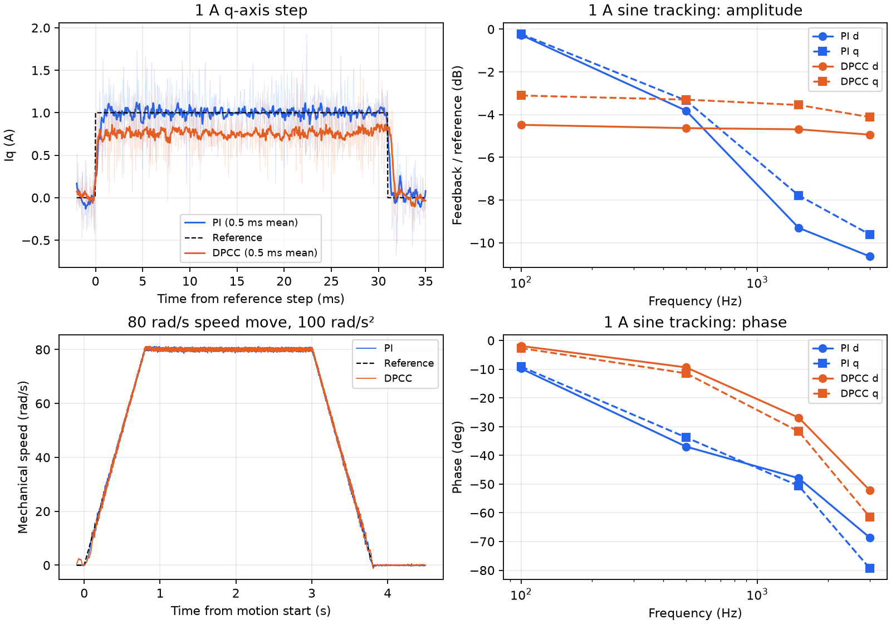
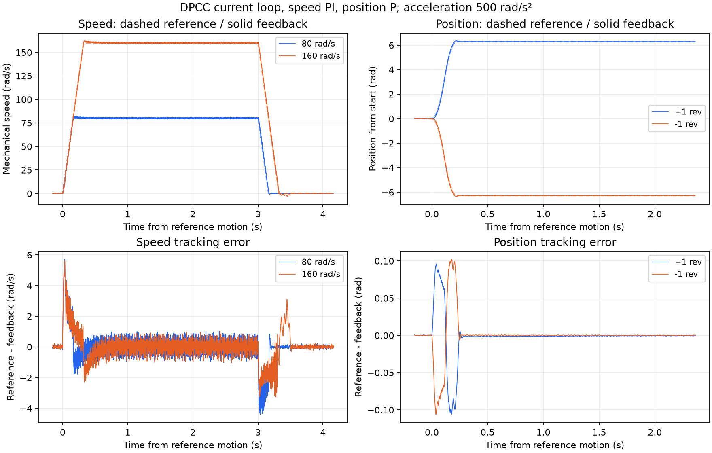

# 电流环 DPCC

## 选择与模型

`Current Controller`（`0x0A08`）在 DISABLED 时选择：`0=PI`、`1=LADRC`、`2=DPCC`，仅 RAM 生效，默认 PI。选用 DPCC 时，有感转矩、速度、位置模式使用 DPCC；辨识、无感及编码器校准使用 PI。

算法位于 `Algo/DPCC.c/.h`，使用 Rs、Ld、Lq、Flux 和机械 ESO 转速，无积分及独立扰动观测器。PI 带宽与手调增益不参与 DPCC 计算。

当前 DPCC 无独立带宽或反馈增益参数；模型系数自动计算。速度控制器增益、位置 Kp 和轨迹参数仍可调整。

DPCC 电流扫频报告参考到反馈的实测幅相及相对低频增益的 −3 dB 跟踪带宽。由于参考与反馈的权重不同，工具不从该响应反推开环、灵敏度及稳定裕度；实时采集和归档重绘使用相同规则。

20 kHz 下，电流采样中心到下一次 PWM 装载约 25 μs。先用上一拍限幅后的电压预测装载时刻的电流，再反算随后 50 μs 的电压。各轴 RL 系数为 `A=exp(-Rs·T/L)`、`B=(1-A)/Rs`；半周期和整周期系数随电机参数更新，在中断外计算。每段内冻结耦合与反电动势项。

上一拍 αβ 电压投影到当前采样坐标；预测使用剩余半周期中点的电压方向，新电压按下一 PWM 中心角度提前。最终复用公共电压矢量限幅与 SVPWM。DPCC 内部已包含耦合与反电动势，公共前馈不会重复叠加，前馈开关也不关闭这些模型项。

## 2026-10-25 实测

母线约 24.9 V，7 极对；临时模型 Rs=0.334347 Ω、Ld=58.443 μH、Lq=75.191 μH、Flux=0.00234 Wb。PI 电流环采用 1250 Hz 模型整定；速度 PI 保持 Kp=0.025、Ki=0.2，机械 ESO 100 Hz。电流激励峰值 1 A，两轴分别测试。

阶跃图细线为原始电流，粗线为 0.5 ms 滑动均值。表中幅值比与相位取正弦基波拟合，不把噪声峰值当成基波幅值。

| 频率 | d 轴 PI 幅值比 / 相位 | d 轴 DPCC 幅值比 / 相位 | q 轴 PI 幅值比 / 相位 | q 轴 DPCC 幅值比 / 相位 |
|---|---|---|---|---|
| 100 Hz | −0.27 dB / −9.75° | −4.48 dB / −1.90° | −0.22 dB / −9.08° | −3.11 dB / −2.64° |
| 500 Hz | −3.81 dB / −36.94° | −4.63 dB / −9.35° | −3.34 dB / −33.75° | −3.30 dB / −11.42° |
| 1500 Hz | −9.30 dB / −47.95° | −4.69 dB / −26.87° | −7.79 dB / −50.61° | −3.55 dB / −31.68° |
| 3000 Hz | −10.64 dB / −68.65° | −4.94 dB / −52.19° | −9.61 dB / −79.36° | −4.12 dB / −61.49° |

| q 轴阶跃，正反向各两次 | PI | DPCC |
|---|---:|---:|
| 1 A 平台末 10 ms 电流均值绝对值 | 0.999～1.001 A | 0.760～0.768 A |
| 回零后 5～25 ms 电流均值 | −0.001～0.001 A | −0.008～0.013 A |
| 同一回零窗口电流标准差 | 0.201～0.222 A | 0.208～0.231 A |

DPCC 的相位滞后较小，但 1 A 阶跃存在约 0.24 A 静差；100 Hz 下 d/q 轴幅值分别约为参考的 60%/70%。两种控制器回零后的电流波动接近，差异主要在跟踪精度。基础 DPCC 没有积分或扰动估计，模型及实际施加电压的误差会留下静差；参数误差与逆变器电压误差的贡献待定位。

电感模型同时缩放、其他参数不变，1 A / 100 Hz 的 DPCC 幅值如下：

| Ld、Lq 模型倍率 | d 轴幅值比 | q 轴幅值比 |
|---|---:|---:|
| 0.8 | 0.537 | 0.639 |
| 1.0 | 0.597 | 0.699 |
| 1.2 | 0.653 | 0.742 |

增大模型电感会提高本轮跟踪幅值，但仍有偏差，因此没有将电感当作补偿增益修改。

速度模式以 ±80 rad/s 往返，加减速度 100 rad/s²；稳态统计取减速前 1 s。位置模式往返 0.5 rad，速度指令上限 10 rad/s，同样采用 100 rad/s²，记录启动 1.5 s 后的位置误差。

| 外环结果 | PI 电流环 | DPCC 电流环 |
|---|---:|---:|
| 速度过程跟踪误差峰值 | 3.10 rad/s | 4.09 rad/s |
| 速度超调峰值 | 1.25 rad/s | 1.34 rad/s |
| 稳态速度均值误差绝对值 | ≤0.004 rad/s | ≤0.004 rad/s |
| 稳态速度标准差 | 0.443～0.457 rad/s | 0.417～0.437 rad/s |
| 速度测试电流参考峰值 | 0.659 A | 0.847 A |
| 两次位置到位误差绝对值 | 0.00019～0.00021 rad | 0.00044～0.00089 rad |

本轮快速控制段最大 13.12 μs，ADC ISR 最大 13.99 μs，PWM 底部到快速中断完成最大 42.95 μs。

对比图及 PI、DPCC 各一份 1 A q 轴阶跃原始波形保存在 [data/20261025_current_dpcc](data/20261025_current_dpcc)。CSV 统计表仅保留在本地 `test-data/20261025_dpcc/local-tables/`。

### 空载速度、位置外环测试

内环固定 DPCC，速度 PI：Kp=0.025、Ki=0.2，位置 P：Kp=40；电机模型同上。采用梯形轨迹，加减速度 500 rad/s²。电流指令由外环生成，沿用原有 10 A 限值。

| 速度目标 | 跟踪误差峰值 | 超调 | 稳态速度标准差 | 电流参考峰值 |
|---|---:|---:|---:|---:|
| +80 rad/s | 5.73 rad/s | 1.78 rad/s | 0.412 rad/s | 1.186 A |
| −80 rad/s | 4.50 rad/s | 2.09 rad/s | 0.430 rad/s | 1.127 A |
| +160 rad/s | 5.63 rad/s | 2.29 rad/s | 0.364 rad/s | 1.164 A |
| −160 rad/s | 5.86 rad/s | 2.14 rad/s | 0.383 rad/s | 1.193 A |

稳态取减速前 1 s，四段速度均值误差绝对值均小于 0.004 rad/s。

位置按 `起点 → +1圈 → 起点 → −1圈 → 起点` 运行，速度上限指令 80 rad/s。到位误差在每段启动 2 s 后读取。

| 位移 | 过程跟踪误差峰值 | 超调 | 到位误差绝对值 | 电流参考峰值 |
|---|---:|---:|---:|---:|
| 起点 → +1圈 | 0.106 rad | 0.0734 rad | 0.00086 rad | 1.270 A |
| +1圈 → 起点 | 0.110 rad | 0.0699 rad | 0.00058 rad | 1.252 A |
| 起点 → −1圈 | 0.106 rad | 0.0660 rad | 0.00028 rad | 1.258 A |
| −1圈 → 起点 | 0.106 rad | 0.0739 rad | 0.00026 rad | 1.290 A |

外环可消除最终速度、位置偏差，但运动中仍有跟踪误差和超调。速度波形及外环原始采样 `outer.npz` 仅保留在本地 `test-data/20261025_dpcc/local-waveforms/`。
